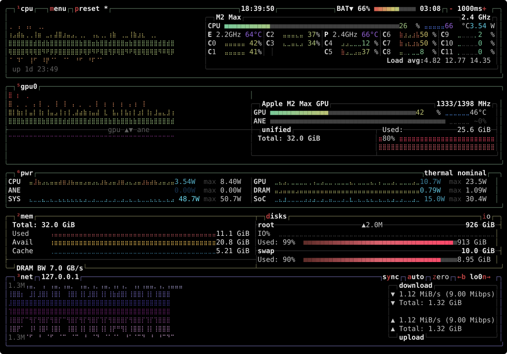
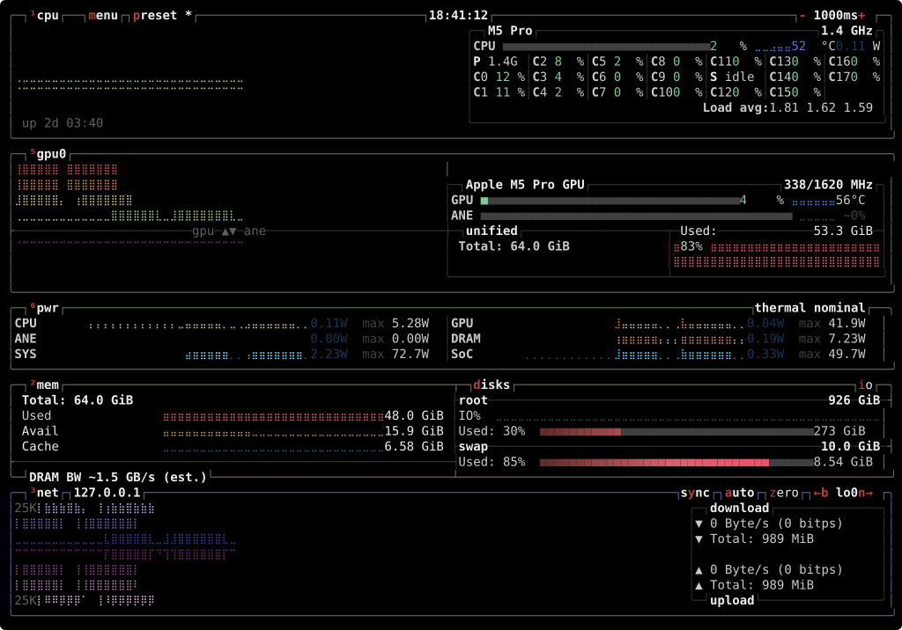

# topo

[](https://github.com/proschinesi/topo/actions/workflows/cmake.yml)

**topo** is a terminal system monitor for Apple Silicon Macs. It is a fork of
[btop++](https://github.com/aristocratos/btop) and keeps its interface, themes, braille graphs and process, memory,
disk and network views. On top of that it reads the SoC data that btop does not show on macOS (Neural Engine,
per-component power, CPU clusters, GPU frequency and temperature, DRAM bandwidth), **without sudo**.



## What topo adds to btop

- **cpu box by cluster**: cores are grouped by performance level (E, P, S), with the average frequency and the
  temperature of each level in its header (`P 3.2GHz 45°C`). The topology comes from `hw.perflevelN`, with no
  per-chip tables.
- **gpu box**: utilization (active residency), current/maximum frequency, power, real temperature; an **ANE** row with
  power and estimated usage; a large graph split into GPU (top) and ANE (bottom); memory shown as `unified`.
  When the pwr box is shown, the gpu box leaves out its own power readings (they are in the pwr box).
- **pwr box** (key `6`): CPU, GPU, ANE, DRAM, system and total SoC power, with the session maximum and the macOS
  thermal state.
- **mem box**: DRAM bandwidth (`DRAM BW x GB/s`), or the estimate `DRAM BW ~x GB/s (est.)` where the direct counter
  is not available.
- **proc box**: optional per-process `Gpu%` column.
- `--dump-soc`: one SoC sample per line as JSON, with the data source of every value.

Where a value is not available topo shows `—`, never a fake 0.

## Install

With Homebrew (builds from source, needs the Xcode Command Line Tools):

```bash
brew install proschinesi/tap/topo
```

From source. Requirements: an Apple Silicon Mac, macOS 26 or later, Apple clang 19 or later (C++23) and CMake.

```bash
git clone https://github.com/proschinesi/topo.git
cd topo
cmake -B build -DCMAKE_BUILD_TYPE=Release
cmake --build build --parallel
ctest --test-dir build          # unit tests (GoogleTest, downloaded at configure time)
./build/topo
```

Add `-DBUILD_TESTING=OFF` to configure without the tests (and without downloading GoogleTest).
To install in your home directory, without sudo:

```bash
cmake --install build --prefix ~/.local
```

This installs `~/.local/bin/topo`, the themes in `~/.local/share/topo/themes` (found by the installed binary) and the
man page if `lowdown` was available at build time. `~/.local/bin` must be in your `PATH`.

Configuration: `~/.config/topo/topo.conf`. Themes are read from `~/.config/topo/themes`, from the btop folders
(`~/.config/btop/themes`, `share/btop/themes`) and from `share/topo/themes`.

## Screenshots

M2 Max (MacBook Pro), 120x40:



M5 Pro (Mac mini), 120x40:



## Tested chips

| Mac | Chip | macOS | Notes |
|---|---|---|---|
| MacBook Pro | M2 Max (4 E + 8 P) | 27.0.1 (26A434) | direct DRAM bandwidth (AMC), cluster temperatures from SMC |
| Mac mini | M5 Pro (12 P + 6 S) | 27.0.1 (26A434) | DRAM bandwidth estimated only, temperatures from SMC |

Other chips (M1, M3, M4, Ultra) have not been tested. The code uses no per-model tables, except the table of CLPC
channels per driver (see below).

### Report your chip

If you run topo on a chip or macOS version that is not in the table, please
[open a chip report](https://github.com/proschinesi/topo/issues/new?template=chip_report.md) with your Mac model,
`sw_vers`, `topo --version`, a screenshot and the output of:

```bash
topo --dump-soc --count 3
```

The JSON contains only hardware readings and the source of each value. Run it while the GPU is busy for a few
seconds (a build, a video, a game), so that the power cross-check described below can complete.

## Metrics and sources

| Metric | Source | Notes |
|---|---|---|
| Per-core usage | `host_processor_info` | same as btop |
| Cluster frequency | IOReport `CPU Stats / CPU Core Performance States` + DVFS tables of the `pmgr` node | weighted by active residency |
| Cluster temperature | HID (`pACC/eACC/sACC`) or SMC `Tp*/Te*/Ts*` | average of the plausible keys, read in rotation (16 per sample) |
| CPU temperature (CPU row) | hottest level | |
| GPU usage and frequency | IOReport `GPU Stats / GPUPH` | |
| GPU power | IOReport `Energy Model / GPU Energy` | CLPC as fallback |
| CPU and ANE power | IOReport CLPC `Energy Counters` (macOS 27), `Energy Model` before | see below |
| GPU temperature | HID (`GPU MTR`, `PMU TP*g`) or SMC `Tg*` | |
| DRAM power | SMC `PZD*` | |
| System power | SMC `PSTR` (then `PDTR`, `PD0R`) | |
| DRAM bandwidth | IOReport `AMC Stats / DCS RD+WR` | where the kernel exposes it |
| Estimated DRAM bandwidth | PMP `DCS BW` histograms | **estimate**, shown with `~` and `(est.)` |
| ANE usage `~x%` | PMP "floor" requests of the ANE | **estimate**, not a measured utilization |
| Thermal state | `NSProcessInfo.thermalState` | nominal, fair, serious, critical |
| Per-process GPU | IORegistry `AGXDeviceUserClient`, `accumulatedGPUTime` | delta between samples, option `proc_gpu` |
| SoC total | CPU + GPU + ANE + DRAM | a sum, not a measurement |

**macOS 27 and CLPC.** On macOS 27 Apple stopped updating the CPU/ANE/DRAM counters of the Energy Model (they stay
at 0). topo rebuilds them from the channels of the AppleCLPC driver, using a table per driver and OS build (ported
from macmon) that has been verified only on macOS 27.0 (26A428) and 27.0.1 (26A434). On every machine the CLPC GPU
counter is cross-checked against `GPU Energy` of the Energy Model, which still works: if for 5 samples in a row,
with the GPU active, the ratio falls outside 0.8-1.25, the CLPC channels are discarded and CPU/ANE power shows `—`.
On an M2 Max under load the ratio is 0.98. Until the check has completed (GPU never active enough), CLPC values are
shown with a leading `~` (`~2.1W`). A value missing for one or two cycles keeps the last reading, then turns into `—`.
The state of the check is in `--dump-soc` (`clpc_check`: `pending`, `verified`, `rejected`).

### Limits: what is not available without sudo, what is an estimate

- topo relies on **private Apple interfaces** (IOReport, SMC, HID sensors, IORegistry). They are undocumented and can
  change with any macOS update; a new macOS build may need a new CLPC table.
- Per-core temperatures: Apple Silicon has sensors per cluster, not per core (btop's per-core temperature columns
  are not shown).
- Real ANE utilization: there is no readable counter; topo shows the power (CLPC) and the `~x%` estimate from the
  PMP floor requests.
- DRAM bandwidth: direct only where the kernel exposes the AMC counters (present on M2 Max, absent on M5 Pro);
  elsewhere it is an estimate.
- Per-process power and energy: they require `powermetrics` and sudo, so they are not available.
- Memory and CPU of processes owned by other users (root, system daemons): not readable without sudo, as in btop.
- SoC total: it is the sum of the parts; system power (SMC) also includes display, SSD, network and losses.

## Usage

| Key | Box |
|---|---|
| `1` `2` `3` `4` | cpu, mem, net, proc (as in btop) |
| `5` | gpu |
| `6` | pwr (SoC power) |

```bash
topo --dump-soc                          # one JSON sample
topo --dump-soc --count 5 --interval 500 # five samples, 500 ms apart
```

### New options (options menu or `topo.conf`)

| Option | Default | Menu section | Effect |
|---|---|---|---|
| `show_ane` | `true` | gpu | ANE row and split GPU/ANE graph in the gpu box |
| `pwr_graphs` | `true` | gpu | one-line graphs in the pwr box; `false` = numbers only |
| `dram_bw_estimate` | `true` | mem | show the PMP estimate of DRAM bandwidth when the direct counter is missing |
| `proc_gpu` | `false` | proc | `Gpu%` column in the proc box (about 2 ms of CPU per update); a GPU client that just appeared counts from the next cycle |

The PMP histograms (estimates) are sampled only when something displays them.

## Overhead

Measured on an M2 Max (macOS 27.0.1) as the CPU time of the process (user + system) over 60 s, startup included,
in a 120x40 window, four runs in parallel; differences between two runs reach 0.2 points.

| Boxes | Update | % of one core |
|---|---|---|
| `cpu mem net proc` (default) | 2000 ms | 0.84 |
| `cpu mem net proc gpu0 pwr` | 1000 ms | 1.39 |
| same with `proc_gpu = true` | 1000 ms | 1.37 |
| `cpu mem net gpu0 pwr` | 1000 ms | 1.06 |
| `cpu` | 1000 ms | 0.80 |
| `mem net proc` (no SoC data) | 1000 ms | 1.34 |

The last row is the btop part (processes, memory, disks, network, drawing), which with all boxes at 1000 ms costs
more than 1% on its own.

Startup costs about 0.17 s of CPU, almost all of it in `IOReportCopyAllChannels` (~80 ms, unavoidable: the
subscription needs the channel list). One SoC sample costs 4-6 ms of CPU, almost all in `IOReportCreateSamples`.

## Based on btop++

topo is a fork of [btop++](https://github.com/aristocratos/btop) by Jakob P. Liljenberg (aristocratos) and the btop
contributors, licensed under the [Apache License 2.0](LICENSE), like topo. Everything not listed above (key bindings,
menus, themes, process management, the full list of options) works as in btop: see the
[btop README](https://github.com/aristocratos/btop#readme) for its documentation. Please report topo problems here,
not to btop.

Credits:

- [btop++](https://github.com/aristocratos/btop) (Apache-2.0, Jakob P. Liljenberg and contributors): the whole
  interface and the collection of processes, memory, network and disks.
- [macmon](https://github.com/vladkens/macmon) (MIT, vladkens): CLPC channel table for macOS 27, DVFS tables,
  residency math, SMC key reading.
- [mactop](https://github.com/metaspartan/mactop) (MIT, Carsen Klock): SMC power keys, PMP histograms, ANE floor
  channels, per-process GPU time from the AGX clients.

Details in [`NOTICE`](NOTICE).

The images in `docs/` are generated from real terminal captures with `python3 -I tools/ansi2svg.py` (standard library
only); the animated one with its `record` mode, which runs topo in a pseudo-terminal and turns 20 updates into a
CSS-animated SVG.
